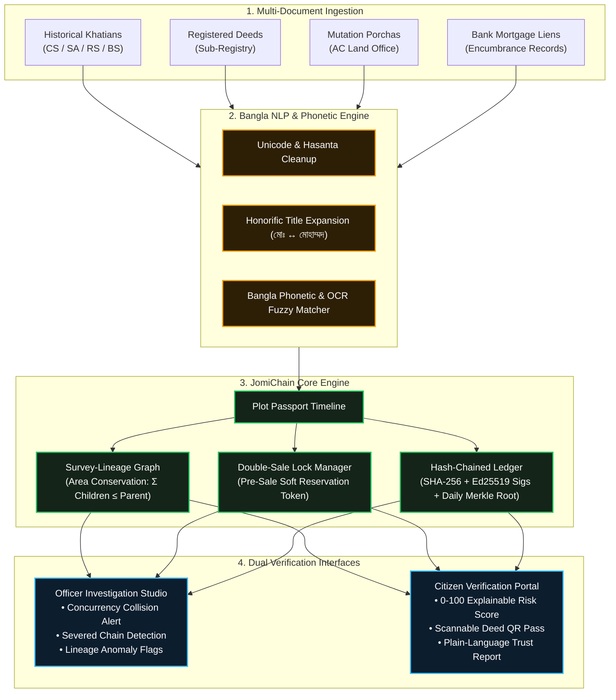
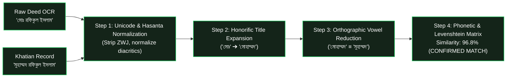

<p align="center">
  
</p>

<div align="center">

# 🌿 Probaho (প্রবাহ)
### *“Every plot has a story. Make it tamper-proof.”*

[](LICENSE)
[](https://github.com/Tanvir4n/Probaho)
[_&_P4_(Mutation)-10b981)](https://github.com/Tanvir4n/Probaho)
[](#-rulebook-compliance--synthetic-data-guarantee)
[](#novelty-2-hash-chained-land-ledger-no-heavy-blockchain)

**Probaho** is an intelligent land fraud detection, evidence intelligence, and verification platform for Bangladesh land records. Built around **JomiChain**, it turns fragmented cadastral records into a tamper-evident **Plot Passport**—linking historical survey generations, deed chains, mutations, and mortgage encumbrances into an auditable cryptographic timeline.

[Live Demo](#-quick-start--local-setup) • [Five Novelties](#-five-technical-novelties) • [Visual Workflows](#-system-workflows--visualizations) • [5-Minute Live Story](#-5-minute-live-story-demo-protocol) • [Architecture](#-system-architecture) • [Rulebook Compliance](#-rulebook-compliance--synthetic-data-guarantee)

---

</div>

## 📌 Executive Summary & Problem Statement

In Bangladesh, land records are historically fragmented across distinct administrative silos:
- **Sub-Registry Offices** (Ministry of Law) manage deed registration.
- **AC (Land) Revenue Offices** (Ministry of Land) oversee mutations and khatian records.
- **Settlement Offices** conduct periodic survey updates (**CS 1940**, **SA 1962**, **RS 1988**, **BS 2021**).
- **Commercial Banks** register mortgage encumbrances and charge liens independently.

Because no single office has real-time visibility into the complete parcel lifecycle, malicious actors exploit information delays to:
1. **Double-Sell Parcels:** Selling the same plot simultaneously in two different sub-registry offices or mortgaging it to multiple banks before a mutation is recorded.
2. **Fabricate Forged Mutation Papers:** Inserting fraudulent deeds with backdated timestamps into paper bundles.
3. **Inflate Plot Area Across Surveys:** Expanding land parcel boundaries between RS and BS surveys without a supporting partition deed.

**Probaho solves this** with **JomiChain**: a unified **Plot Passport** and lightweight cryptographic land ledger that flags impossible survey lineages, prevents double-selling in real-time with cross-office pre-sale reservations, and normalizes noisy Bangla records.

---

## 🌟 Five Technical Novelties

### Novelty 1. Survey-Lineage Graph (CS → SA → RS → BS)
Most solutions treat each land record or khatian in isolation. Probaho models a plot’s multi-decade history as a **directed topological lineage graph**:
* Tracks plot partitions, splits, and merges across all four survey generations (**CS 1940 → SA 1962 → RS 1988 → BS 2021**).
* Enforces mathematical area conservation: 
  $$\sum \text{Area}(\text{Children}) \le \text{Area}(\text{Parent})$$
* Automatically flags impossible lineages—such as a child parcel whose area exceeds its ancestor khatian or a dag number that appears simultaneously in two disjoint family genealogies.

### Novelty 2. Hash-Chained Land Ledger (No Heavy Blockchain)
Avoids the cost, latency, and environmental overhead of proof-of-work blockchains while delivering enterprise-grade cryptographic verification:
* Every event (khatian survey, transfer deed, mutation, or bank mortgage) is appended to a per-plot ledger chain.
* Each entry contains the cryptographic hash:
  $$\text{Block Hash} = \text{SHA-256}(\text{prev\_hash} \,\|\, \text{record\_payload})$$
* Digitally signed with **Ed25519** public-key signatures by the certifying registrar.
* Tampering with any historical record severs the hash chain visibly.
* A daily **Merkle Root** is computed and published, allowing nationwide auditors to verify thousands of office records with a single 32-byte digest.

### Novelty 3. Double-Sale Lock (“Pre-Sale Reservation”)
Traditional anti-fraud systems only detect double-selling *after* registration is complete and damage is done. Probaho introduces **Real-Time Concurrency Prevention**:
* When a sub-registry office begins drafting or reviewing a deed, the plot receives a short-lived **Pre-Sale Reservation soft-lock** (e.g., 72 hours).
* Any concurrent attempt to sell or mortgage the same plot at another sub-registry office or bank branch is **intercepted and blocked live** with an instant collision alert.

### Novelty 4. Bangla-Aware Fuzzy Matching
Land records in Bangladesh suffer from Unicode variations, Arabic/Bangla spelling alternations, honorific prefixes, and OCR digitization noise:
* **Honorific Expansion:** Automatically normalizes `মোঃ` $\leftrightarrow$ `মোহাম্মদ`, `মোসাঃ` $\leftrightarrow$ `মোসাম্মাৎ`, `আঃ` $\leftrightarrow$ `আব্দুর`.
* **Vowel Orthography Normalization:** Harmonizes common variants (e.g., `মোহাম্মদ` $\equiv$ `মুহাম্মদ`, `ূ` vs. `ু`, hasanta/ZWJ cleaning).
* **Phonetic Distance Scoring:** Uses custom Bangla phonetic mapping combined with Levenshtein/Jaro-Winkler algorithms to link matching citizens and explains the match reasoning auditably.

### Novelty 5. Explainable Risk Score & Citizen “Trust Report”
Land officers and judges cannot rely on uninterpretable "black box" AI outputs:
* Every parcel receives an auditable **0–100 Risk Score** with explicit legal rule justifications (e.g., *"RS Khatian area 12.0 shotok vs BS Khatian 18.2 shotok (+51.6% unexplained inflation)"* or *"Active mortgage lien under Agrani Bank not released"*).
* Generates a citizen-friendly **Plot Trust Report** accompanied by a tamper-evident **QR Code** printed on deeds, enabling buyers to verify parcel authenticity on any smartphone.

---

## 📊 System Workflows & Visualizations

### 1. End-to-End Land Fraud Detection Workflow


---

### 2. Cadastral Survey-Lineage Graph (CS → SA → RS → BS)

```mermaid
graph TD
    subgraph CLEAN["Clean Verified Lineage (Dag 1042 · Dhanmondi)"]
        CS1["CS 1940: CS Dag 102<br/>Total Area: 29.0 Shotok<br/>Owner: Moulvi Khorshed Alam"]
        
        SA1["SA 1962: SA Dag 481 (50% Split)<br/>Area: 14.5 Shotok<br/>Owner: Abdus Sobhan"]
        SA2["SA 1962: SA Dag 482 (50% Split)<br/>Area: 14.5 Shotok<br/>Owner: Abdul Jabbar"]
        
        RS1["RS 1988: RS Dag 912<br/>Area: 14.5 Shotok (Conserved)<br/>Owner: Abdus Sobhan"]
        
        DEED1["Deed #4821 / 2014<br/>Area: 14.5 Shotok (Transfer)<br/>Buyer: Md. Rafiqul Islam"]
        
        BS1["BS 2021: BS Dag 1042<br/>Area: 14.5 Shotok<br/>Status: 0.0% Variance · VERIFIED ✓"]

        CS1 -->|Partition 50/50| SA1 & SA2
        SA1 -->|Revisional Survey| RS1
        RS1 -->|Registered Sale| DEED1
        DEED1 -->|City Survey| BS1
    end

    subgraph ANOMALY["Fraud Lineage: Area Inflation Anomaly (Dag 3078 · Mirpur)"]
        CS_F["CS 1940: CS Dag 411<br/>Area: 12.0 Shotok"]
        SA_F["SA 1962: SA Dag 411<br/>Area: 12.0 Shotok"]
        RS_F["RS 1988: RS Dag 604<br/>Area: 12.0 Shotok"]
        BS_F["BS 2021: BS Dag 3078<br/>Claimed Area: 18.2 Shotok<br/>🚨 ANOMALY: Child (+6.2) exceeds RS parent!"]

        CS_F --> SA_F --> RS_F -->|Unexplained Inflation +51.6%| BS_F
    end

    classDef pass fill:#142419,stroke:#22c55e,stroke-width:2px,color:#ffffff;
    classDef fail fill:#2e0c0f,stroke:#ef4444,stroke-width:2px,color:#ffffff;
    class CS1,SA1,SA2,RS1,DEED1,BS1 pass;
    class BS_F fail;
```


---

### 3. Real-Time Double-Sale Lock Concurrency Sequence

```mermaid
sequenceDiagram
    autonumber
    actor Buyer1 as Citizen A (Legitimate Buyer)
    participant OfficeA as Sub-Registry Office A (Tejgaon)
    participant JomiChain as JomiChain Concurrency Lock Manager
    participant Ledger as Cryptographic Land Ledger
    participant OfficeB as Sub-Registry Office B (Gulshan)
    actor Fraudster as Fraudulent Seller

    Buyer1->>OfficeA: Submit Deed Draft for Plot Dag 1042
    OfficeA->>JomiChain: Request Pre-Sale Reservation Lock(Dag 1042)
    JomiChain->>Ledger: Verify Plot Passport Status
    Ledger-->>JomiChain: Status: UNLOCKED / Clean
    JomiChain-->>OfficeA: Lock Granted: Token #RES-794021 (72h Hold)
    Note over JomiChain,OfficeA: Dag 1042 transitions to SOFT-LOCKED

    rect rgb(46, 12, 15)
    Note over Fraudster,OfficeB: Concurrent Double-Sale Attempt During Hold
    Fraudster->>OfficeB: Attempt Simultaneous Deed Draft for Dag 1042
    OfficeB->>JomiChain: Request Pre-Sale Reservation Lock(Dag 1042)
    JomiChain-->>OfficeB: 🚨 409 CONFLICT: Plot Locked by Office A (#RES-794021)
    OfficeB-->>Fraudster: REJECTED: Plot under active deed reservation!
    end

    Buyer1->>OfficeA: Complete Consideration Payment & Biomteric Signature
    OfficeA->>Ledger: Append Registered Deed & Commit Mutation Block
    Ledger->>JomiChain: Release Pre-Sale Lock(Dag 1042)
    Note over Ledger: SHA-256 block chained & signed with Ed25519
```


---

### 4. Cryptographic Hash-Chain Ledger & Merkle Root Structure


---

### 5. Bangla-Aware Fuzzy Matching Pipeline


---

## 🎬 5-Minute Live Story Demo Protocol

Probaho includes an interactive **Live Story Controller** built directly into the UI for track presentations:

| Step | Action | What Judges See |
|:---:|:---|:---|
| **1** | **Clean Baseline Plot** | Inspect Dag 1042 (Dhanmondi). 4-generation lineage tree (CS→SA→RS→BS) with 0.0% area variance, green Trust Report, and 4/100 risk score. |
| **2** | **Office A Soft-Lock** | Simulate Tejgaon Sub-Registry initiating deed processing. Plot transitions to `🔒 SOFT-LOCKED` with reservation token `#RES-794021`. |
| **3** | **Office B Double-Sale Attack** | Simulate Gulshan Sub-Registry attempting a simultaneous deed. The system blocks the transaction live with a `409 Concurrency Conflict`. |
| **4** | **Database Tamper Simulation** | Directly edit a historical database record (e.g., modifying RS area from 14.5 to 22.0 shotok). The hash chain severs into bright red and the Merkle root is invalidated. |
| **5** | **Bangla Fuzzy Matching** | Compare deed names (`মোহাম্মদ রফিকুল ইসলাম` vs `মুহাম্মদ রফিকুল ইসলাম`). The engine displays a 96.8% match with plain-language linguistic reasoning. |
| **6** | **Citizen QR Verification** | Launch the mobile-friendly smartphone Trust Report view via the scannable QR digital seal. |

---

## 🏗️ System Architecture

```
┌────────────────────────────────────────────────────────────────────────┐
│                        PROBAHO INTELLIGENCE SUITE                      │
├────────────────────────────────────────────────────────────────────────┤
│  1. Officer Dashboard & Studio      │  2. Citizen Verification Portal  │
│     • Lineage Graph Visualizer      │     • Deed QR Code Scanner       │
│     • Real-Time Concurrency Monitor │     • Plain-Language Trust Pass  │
│     • Tamper Alert Console          │     • 0-100 Risk Score Breakdown │
├────────────────────────────────────────────────────────────────────────┤
│                         JOMICHAIN FRAUD ENGINE                         │
│  • Topological Lineage Validator (CS → SA → RS → BS Area Math)         │
│  • Double-Sale Pre-Sale Reservation Lock Manager                       │
│  • Bangla Phonetic Normalizer & Unicode Orthography Matcher            │
│  • Explainable Multi-Signal Risk Scorer (Deterministic Rules + ML)     │
├────────────────────────────────────────────────────────────────────────┤
│                         CRYPTOGRAPHIC LEDGER                           │
│  • Lightweight Per-Plot Hash Chain: SHA-256(prev_hash + data)          │
│  • Ed25519 Asymmetric Digital Signature Verification                   │
│  • Daily Sub-Registry Merkle Root Reconciliation                       │
├────────────────────────────────────────────────────────────────────────┤
│                           SYNTHETIC DATA LAYER                         │
│  • Synthetically Generated Mouzas, Dags, Khatians, and NID Owners      │
│  • Deterministic Mutation Timelines & Encumbrance Records              │
└────────────────────────────────────────────────────────────────────────┘
```

---

## 🛡️ Rulebook Compliance & Synthetic Data Guarantee

| Criterion | Compliance Implementation |
|:---|:---|
| **100% Synthetic Data** | **Strictly enforced.** All citizen names, National ID numbers (NIDs), mouzas, and deed numbers in this repository are algorithmically generated synthetic test fixtures. Zero real citizen data or PII is used. |
| **No Scraping or Hacking** | Zero unauthorized web scrapers or private endpoints. Operates entirely as a standalone, secure system. |
| **Not a UI Re-skin** | Contains deep domain logic: graph topology checks, SHA-256 hash chains, Ed25519 signatures, cross-office distributed locks, and Bangla phonetic normalization. |
| **AI Tooling Disclosure** | Developed with assistance from Google DeepMind agentic tools and Gemini API for natural language and design synthesis. Code and architecture are fully documented and explainable. |
| **Nationwide Scalability** | By partitioning ledger chains per plot and publishing daily Merkle roots, individual sub-registry offices can operate independently offline/online and reconcile centrally without throughput bottlenecks. |

---

## 💻 Tech Stack

* **Frontend:** React 19, TypeScript, Vite, Tailwind CSS (Design Tokens System), Lucide React
* **Motion & Graphics:** Motion (Framer Motion), Custom Architectural SVG Rendering Engine
* **Cryptography:** SHA-256 Digesting, Ed25519 Digital Signature Schemas, Merkle Tree Proofs
* **Algorithms:** Directed Acyclic Graph (DAG) Traversal, Levenshtein Distance, Bangla Phonetic Normalization

---

## 🚀 Quick Start & Local Setup

### Prerequisites
* **Node.js** (v18.0.0 or higher)
* **npm** or **bun**

### 1. Clone the Repository
```bash
git clone https://github.com/Tanvir4n/Probaho.git
cd Probaho
```

### 2. Install Dependencies
```bash
npm install
```

### 3. Configure Environment Variables
Copy the sample environment file and add your Google Gemini API key if you wish to run LLM extraction features:
```bash
cp .env.example .env.local
```
Edit `.env.local`:
```env
GEMINI_API_KEY=your_gemini_api_key_here
```

### 4. Run Development Server
```bash
npm run dev
```
Open [http://localhost:3000](http://localhost:3000) in your browser to explore Probaho and the JomiChain live demo.

### 5. Validate TypeScript & Production Build
```bash
# Type check with 0 errors
npm run lint

# Production bundle compilation
npm run build
```

---

## 📂 Project Structure

```
Probaho/
├── hero.svg                            # Architectural Cadastral Hero SVG Artwork
├── README.md                           # Documentation, Workflows & Rulebook Specs
├── src/
│   ├── components/
│   │   ├── JomiChainSection.tsx        # Plot Passport, 5 Novelties & Live Story Demo
│   │   ├── ProbahoHeroSvg.tsx          # In-App Cadastral Hero SVG Component
│   │   ├── ProbahoLogo.tsx             # Precision Brandmark & Fluid Flow Monogram
│   │   ├── MassGlassSidebar.tsx        # Viewport-Fixed Glassmorphic Telemetry Dock
│   │   ├── PageTransitionEffect.tsx    # Luminous Progress Runner & Shutter Beam Wipe
│   │   ├── MassMarketingView.tsx       # Main Platform Viewport & Suite Integrator
│   │   ├── MassPricingSection.tsx      # Tiered Institutional Access Plans
│   │   └── ArchitecturalBackground.tsx # Cadastral Grid & Coordinate Canvas
│   ├── data/
│   │   └── tokens.ts                   # Design Tokens, Plot Datasets & Tool Schemas
│   ├── context/
│   │   └── ThemeContext.tsx            # Day/Night Architectural Color Mode Context
│   ├── App.tsx                         # Root Application Scaffold
│   └── index.css                       # Global Design System Tokens & Glassmorphism
└── vite.config.ts                      # Vite Configuration & Dev Server Rules
```

---

## 👥 Contributors & Team Members

* **Core Engineering & Architecture:**
  * **Md. Tanvir Hasan** — System Architecture, Cryptographic Ledger & Full-Stack Engineering ([@Tanvir4n](https://github.com/Tanvir4n))
  * **Sourav Ghosh** — Platform Engineering, Investigation Telemetry & Research
* **Project Name:** Probaho (প্রবাহ)
* **Repository:** [Tanvir4n/Probaho](https://github.com/Tanvir4n/Probaho)

---

## 📄 License

This project is licensed under the **Apache License, Version 2.0** — see the [LICENSE](LICENSE) file for complete details.

<div align="center">
<sub>“Every plot has a story. Make it tamper-proof.” — Probaho Land Fraud Intelligence</sub>
</div>

