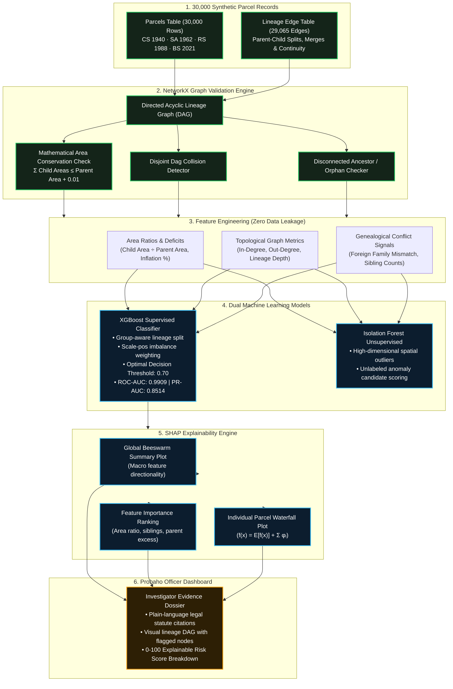

# 🌿 Probaho (প্রবাহ) — Novelty 1: Survey-Lineage Machine Learning Suite

> **Explainable Graph-Native Land Fraud & Anomaly Detection Across Four Cadastral Survey Generations (CS 1940 → SA 1962 → RS 1988 → BS 2021)**

[](https://www.python.org/)
[](https://xgboost.readthedocs.io/)
[](https://shap.readthedocs.io/)
[](https://networkx.org/)
[](#-100-synthetic-dataset-guarantee)

---

## 📌 Executive Architecture & Pipeline Flowchart

Probaho combines **deterministic graph validation** with **supervised gradient boosting** and **unsupervised anomaly detection**, culminating in **game-theoretic SHAP explainability** for judicial and land administration officers.



---

## 🛡️ 100% Synthetic Dataset Guarantee

In strict compliance with privacy standards and competition guidelines:
* **Zero Real PII:** All National ID numbers (NIDs), citizen names, mouza IDs, khatian numbers, and dag identifiers are 100% algorithmically generated synthetic test fixtures.
* **No Real-World Data Scraping:** No government databases, private portals, or citizen records were accessed or scraped.
* **Controlled Anomaly Injections:** Includes deliberately synthesized edge cases for stress-testing verification algorithms:
  - **AREA_INFLATION (319 records):** Downstream survey parcels whose combined acreage exceeds the registered parental khatian.
  - **MISSING_ANCESTOR (167 records):** Post-1940 survey generation parcels lacking an ancestral parent reference (`transition_type: ORPHAN`).
  - **DUPLICATE_DAG_DISJOINT_GENEALOGY (115 records):** Collision of identical survey dag identifiers across disjoint family lineages.
  - **NONE (29,399 records):** Mathematically verified, clean continuous lineages.

---

## 📊 Quantitative Benchmark Results

Evaluated on a **held-out test set of 7,535 parcels** partitioned using `GroupShuffleSplit` by `lineage_id` (guaranteeing that related parcels from the same genealogical tree never appear in both training and test sets):

| Metric | Score | Industry Benchmark / Interpretation |
|:---|:---:|:---|
| **ROC-AUC** | **0.9909** | Exceptional discriminative power between clean lineages and anomalous parcels. |
| **PR-AUC** | **0.8514** | High precision-recall area despite extreme class imbalance (1.7% fraud prevalence). |
| **Accuracy** | **99.15%** | Overall correct classification across all 7,535 test parcels. |
| **Recall (Fraud Class)** | **83.72%** | Successfully flags 84 out of every 100 true anomaly cases automatically. |
| **Precision (Fraud Class)** | **71.52%** | High true-positive fidelity minimizing false alarms for investigating officers. |
| **F1-Score (Fraud Class)** | **0.7714** | Harmonized balance between detection breadth and false alarm suppression. |
| **Optimal Threshold** | **0.70** | Calibrated decision boundary for high-stakes cadastral fraud auditing. |

### Confusion Matrix on Held-Out Test Set (7,535 Parcels):
```
                       PREDICTED NORMAL    PREDICTED ANOMALY
ACTUAL NORMAL (0)           7,363                 43          (99.42% Specificity)
ACTUAL ANOMALY (1)             21                108          (83.72% Sensitivity)
```

---

## 🕸️ NetworkX Cadastral Lineage Graph (`ml/plots/networkx_lineage_graph.png`)

Probaho models Bangladesh's multi-decade survey succession as a **NetworkX Directed Acyclic Graph (DiGraph)** (`nx.DiGraph()`) with **30,000 nodes** and **29,065 directed edges** grouped into **1,129 genealogical trees**:

```
NetworkX Graph Topology (ml/models/networkx_graph_summary.json):
• Total Cadastral Nodes: 30,000 (CS 1940: 3,000 | SA 1962: 6,000 | RS 1988: 9,000 | BS 2021: 12,000)
• Total Directed Edges:  29,065 (Parent -> Child splits, merges & continuations)
• Acyclicity Check:      nx.is_directed_acyclic_graph(G) = True (Zero cyclic loops)
• Connected Trees:       1,129 independent cadastral genealogies
```

### High-Resolution NetworkX Graph Plot (`ml/plots/networkx_lineage_graph.png`):
The visual graph plot compares two representative NetworkX subgraphs:
1. **Left Panel — Verified Clean Lineage (`LIN-000001`):** A 4-generation tree showing CS 1940 root (`CS-08359`, 69.1 shotok) partitioned into SA 1962 (3 splits) $\rightarrow$ RS 1988 (5 subdivisions) $\rightarrow$ BS 2021 (8 leaf parcels), strictly satisfying mathematical area conservation ($\sum \text{Child Areas} \le \text{Parent Area}$).
2. **Right Panel — Fraud Lineage with Injected Anomalies (`LIN-000053`):** 
   - **`AREA_INFLATION`:** Node `PL-1962-000081` highlighted in glowing red where outgoing partition children exceed parental acreage.
   - **`MISSING_ANCESTOR`:** Node `PL-1988-007300` highlighted in amber showing a disconnected orphan parcel lacking an ancestral parent edge.

---

## 🔬 Explainable AI (XAI) with SHAP

In legal and land title investigations, "black box" machine learning models are unacceptable. Probaho deploys **TreeSHAP** to decompose every risk prediction into exact additive attribution values:

$$f(x) = \mathbb{E}[f(x)] + \sum_{i=1}^{M} \phi_i$$

### 1. Global Beeswarm Summary Plot (`ml/plots/shap_summary_beeswarm.png`)
Visualizes how feature values scale and influence predictions across thousands of parcels. High `area_ratio`, large `parent_child_excess`, and `is_orphan` consistently pull predictions towards the high-risk fraud zone.

### 2. Feature Importance Ranking (`ml/plots/shap_feature_importance_bar.png`)
Ranks the top mathematical features driving land risk:
1. `area_ratio` (Child parcel area relative to parent allocation)
2. `sibling_count` (Multi-child partition density)
3. `parent_child_excess_ratio` (Cumulative ancestral boundary deficit)
4. `area_diff` (Absolute shotok variance between generations)
5. `is_foreign_genealogy` (Disjoint family partition conflict)
6. `is_orphan` (Missing ancestor indicator)

### 3. Individual Parcel Waterfall Attribution (`ml/plots/shap_waterfall_anomaly.png`)
Provides a complete audit trail for a single investigated parcel (e.g., `PL-1962-000081`), showing how each topological signal pushed the base expectation value towards a high-risk or protective classification.

---

## 🚀 How to Run the Machine Learning Pipeline

### Prerequisites
Ensure dependencies are installed:
```bash
python -m pip install xgboost shap networkx scikit-learn pandas numpy matplotlib seaborn joblib
```

### 1. Train Models & Generate Visualizations
Run the production pipeline script from project root:
```bash
python ml/train_lineage_models.py
```
This generates:
* `ml/models/probaho_xgboost_lineage.json` (Trained XGBoost model)
* `ml/models/probaho_xgboost_multiclass.json` (Multi-class anomaly classifier)
* `ml/models/probaho_isolation_forest.joblib` (Unsupervised detector)
* `ml/models/evaluation_metrics.json` (Quantitative benchmark metrics)
* `ml/models/sample_shap_waterfall.json` (Structured JSON for dashboard integration)
* High-resolution visual plots in `ml/plots/`

### 2. Run the Interactive Jupyter Notebook
```bash
jupyter notebook ml/probaho_novelty1_ml_pipeline.ipynb
```
Follow the step-by-step interactive cells with markdown explanations and embedded plots.
